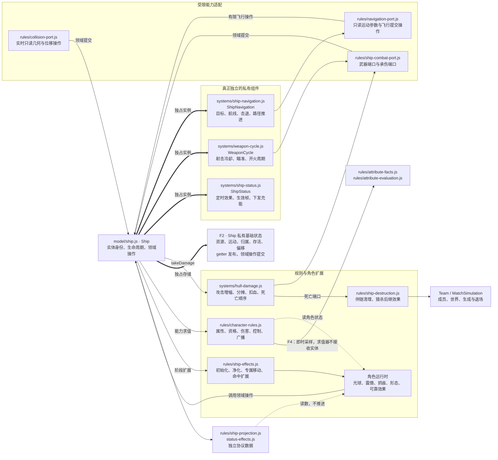
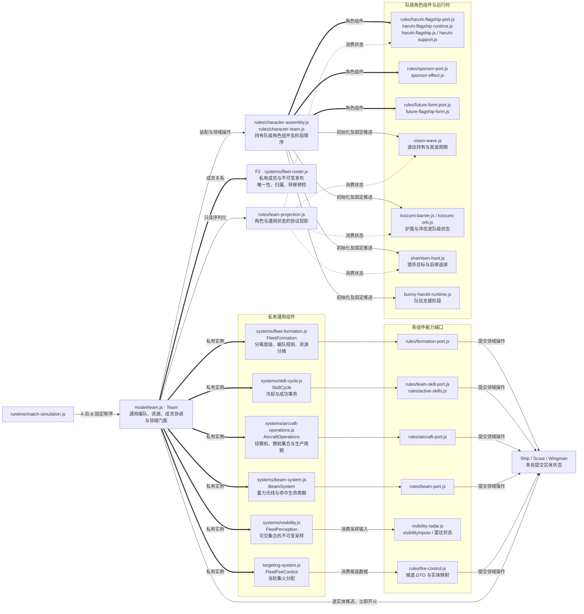
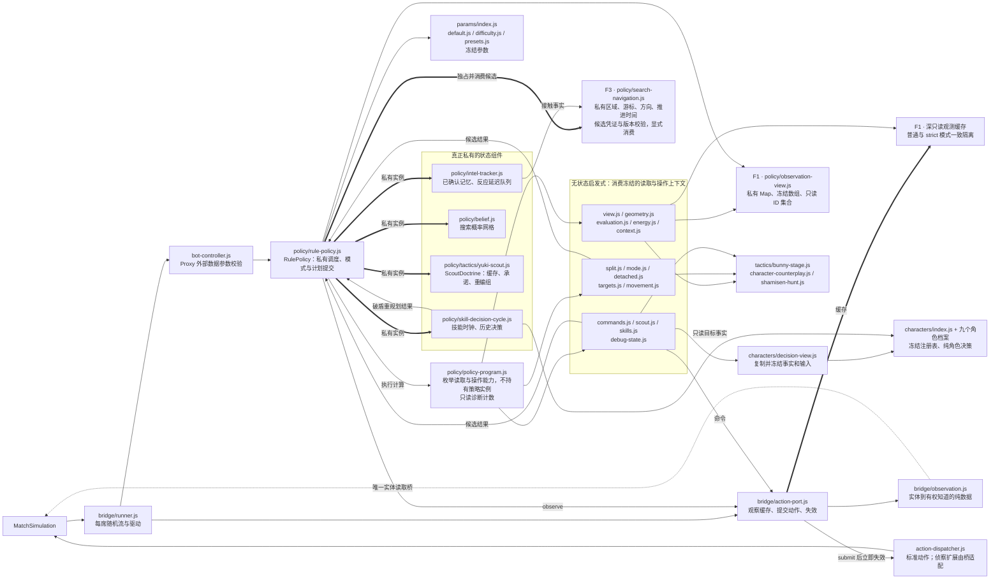
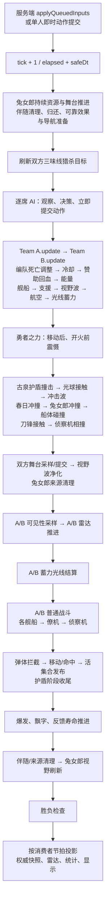
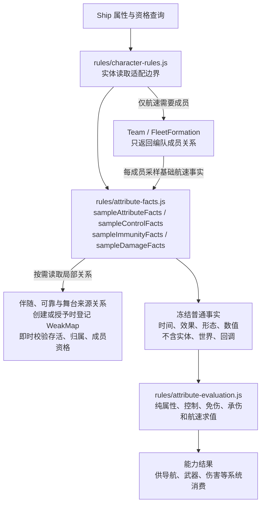
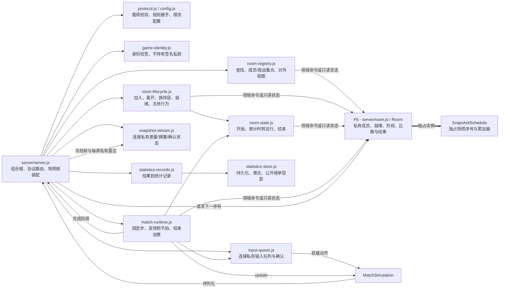

# 游戏模块架构图与状态所有权

源码基线：`221c077`，F1～F6 重构后，2026-10-11。原始问题及探针保留在 Git 提交 `c30d1a2`；本图展示落实后的结构，实施和验收见 [重构记录](architecture-refactor.md)。

这是一张分成八个视图的架构地图。图中的箭头按标签表示调用、数据流或状态持有，不等同于 import；模块名省略共同目录时在图前注明。`F1`～`F6` 对应后面的完成对照。静态模块全量索引见 [模块索引](architecture-module-index.md)。

核心写权限已由对应所有者收回：实体和组件发布只读状态，AI 只消费冻结观测与候选，角色求值消费事实，角色装配与固定阶段归角色层，房间聚合独占成员和生命周期。图中仍保留必要的跨所有者命令与适配关系；它们必须通过领域操作同步完成，不能退回共享字段赋值。

## 图一：权威、输入、传输与表现

关键边界：单人会话与联机传输已经隔离权威和显示。AI 不从显示插值取数据。服务端公开快照与每席雷达分开装配；不能把“所有 UI 都读同一份世界快照”误解为所有玩家都获得相同的私有雷达。

## 图二：Ship 内部职责与写权限

下列相对路径均位于 `shared/game/`。

导航、武器、效果分别持有自己的状态，Ship 持有基础机体与生命周期。生命、能量、坐标、存活和归属不能直接赋值；角色效果只能提交位移、资源计划、伤害等领域操作。Scout/Wingman 同样私有持有运动、任务、武器和寿命，任务输入隔离引用，成员发布和转移校验归属与唯一性。

## 图三：Team 的组件与角色装配边界

角色效果要生成实体或转移阵营时，会调用集合所有者的领域操作；这种跨所有者命令本身是合理的。集合所有者现在统一验证唯一性和归属，实体转移先验证后修改双方成员。伴随转换先预检，再同步清理可靠效果和弹体、提交角色状态；失败不产生部分副作用。

## 图四：九角色的运行时与消费关系

| 角色 | 主要权威状态所有者 | 写入/消费的特殊约束 |
| --- | --- | --- |
| 春日 | 强化组件、支援来源存储、勇者之力运行时 | 强化与支援解锁顺序不变；震慑必须在开火前生效 |
| 兔女郎春日 | 形态/舞台运行时、支援来源存储 | 形态和解锁一起发布；双方舞台先采样后提交 |
| 伴随阿虚 | 伴随运行时、每个接收者的可靠效果、舰体资源 | 母舰关系、临时策反、归还、弹体清理保持同步事务 |
| 阿虚 | ShipStatus 与舰体资源；被动倍率是规则查询 | 增益生效帧保护；回血只通过舰体操作 |
| 长门 | 雷达运行时、航空组件、Scout 自身 | 出生时采样战斗能力；策反后不能错误重新采样身份 |
| 古泉 | 护盾/光球模块的私有状态 | 特殊移动与接触资格即时可见；命中历史不泄露 |
| 未来1096 | FutureFlagshipForm、BeamSystem | 形态先提交再换算；光线先固定命中集合再投递 |
| 鹤屋 | SponsorEffect；策反由适配事务协调 | 阵营/集合/伴随效果一起变更；失败退款顺序不改 |
| 朝仓 | 视野波运行时、ShipStatus | 净化双方先采样；同帧新增效果的保护不能被顺序吞掉 |
| 三味线 | 猎杀与抓痕模块、ShipStatus | 攻击增幅先于分摊；击杀后继效果同步完成 |

角色身份、具体效果 ID 和策略中的角色战术本来就属于领域知识，不能因为出现 `characterId` 就判定耦合错误。真正要限制的是角色模块获得的写权限、对世界对象的可达范围，以及接入新角色时需要修改的中心模块数量。

## 图五：AI 的实际内部结构

相对路径位于 `shared/game/ai/`，BotController 位于上一级。

AI 没有实体兼容通道。观测与索引只读；搜索候选查询不推进游标，实际命令显式消费候选。启发式不再安装到 RulePolicy 原型，执行上下文没有字段写权；模式、卡死采样、移动和分离结果返回协调器提交。诊断只读，不靠覆写策略方法采样。情报外推只在同一观测和参数下复用，动作后立即失效。

## 图六：实际单帧顺序

此图来自 `MatchSimulation.update()`，保持代码顺序。箭头是先后顺序，不是模块 import。A、B 的顺序是当前行为的一部分。

不能把所有状态“延后统一消费”。伤害分摊、死亡、封印、支援、净化、技能冷却及后续 AI 观察都存在同帧因果关系。可集中的是各状态的写入所有者和阶段入口；只对需要公平同时观察的规则先统一采样，例如双方舞台与净化目标。

## 图七：属性、控制与承伤的事实求值

不再存在 `FleetFormation → member.baseSpeed() → 角色 → 世界扫描` 的求值回绕。属性变化仍即时采样：变身、分离、封印、策反、净化和死亡影响同帧后续查询，不在帧头统一缓存。适配层可读取实体，纯求值器不能；生成与转移等事务仍需跨所有者协调，不能把事务适配误称为纯函数。

## 图八：服务端房间、状态与持久边界

房间成员、就绪、阶段和结算统一由 Room 提交。连接层仍负责权限、通知和连接记录，运行器通过领域命令推进比赛和快照时钟；它们不能直接修改房间字段。观战集合、席位、就绪和结果均只读，历史视图不追随后续提交。

## F1～F6 完成对照

| 项 | 实际所有者与契约 | 反向验证 |
| --- | --- | --- |
| F1 观测与索引 | action-port 深冻结；ObservationView 私有索引 | 普通/strict 写入拒绝，历史观测稳定，成功及失败动作后失效 |
| F2 实体与成员 | Ship/Scout/Wingman 私有状态；FleetRoster/AircraftOperations 独占发布 | 标量/嵌套修改拒绝；重复、错误归属、跨对局拒绝；转移失败无部分副作用 |
| F3 AI 内部多写 | SearchNavigation 候选及消费；RulePolicy 私有计划与调度；PolicyProgram 只读上下文 | 重复查询不推进；伪造、过期、重复候选拒绝；外部不能写计划与时钟 |
| F4 求值回绕 | 按用途采样的冻结事实与纯求值器；局部来源关系 | 无实体/回调；历史稳定；同帧变身、净化与归属变化立即生效 |
| F5 角色接入 | CHARACTER_ASSEMBLY；队级/对局角色所有者；独立投影 | 核心实体不再持有具体角色组件或列举推进；固定阶段拒绝未声明入口 |
| F6 房间多写 | Room 聚合；SnapshotSchedule | 重复席位、冒名就绪、外部赋值拒绝；倒计时/运行/完成及快照顺序保持 |

对应源码分别见 [观测端口](../shared/game/ai/bridge/action-port.js)、[舰船](../shared/game/model/ship.js)、[搜索所有者](../shared/game/ai/policy/search-navigation.js)、[属性事实](../shared/game/rules/attribute-facts.js)、[角色装配](../shared/game/rules/character-assembly.js)、[房间聚合](../server/room.js)。测试入口为 `scripts/verify-domain-boundaries.mjs`，完整证据记录在重构记录中。

## 保留的合理耦合与验收边界

- 角色规则知道角色身份、形态及效果含义；通用算法只消费能力或事实。封装的目标是限制权威存储和职责，不是消除全部领域依赖。
- 角色事务适配层负责生成、转移、清理、命中等跨所有者操作，仍会取得领域实体；它只能使用领域命令，不能直接修改私有存储。纯求值层不取得这些能力。
- Team/Match 保留领域门面，已有调用者和测试可调用明确操作；角色状态、投影和阶段顺序已转交对应所有者，门面不再保存第二份状态。
- 冻结 AI 观测、事实和历史会产生分配开销；只在有明确身份和失效规则的地方复用。没有通过改变规则、延迟到帧尾或重刷回放来换取性能。
- 自动化覆盖固定种子、全部核心角色、浏览器和本地网络；不能推导出任意对局穷尽证明，也不替代真人多端体验。未推送、未部署。
