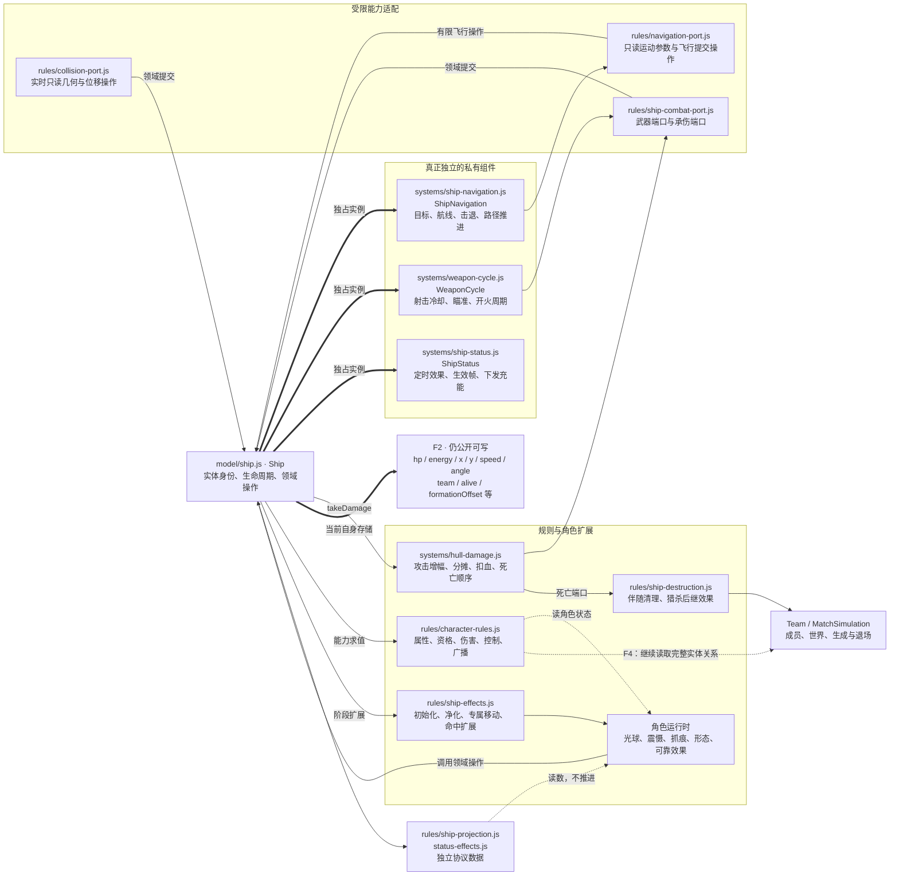
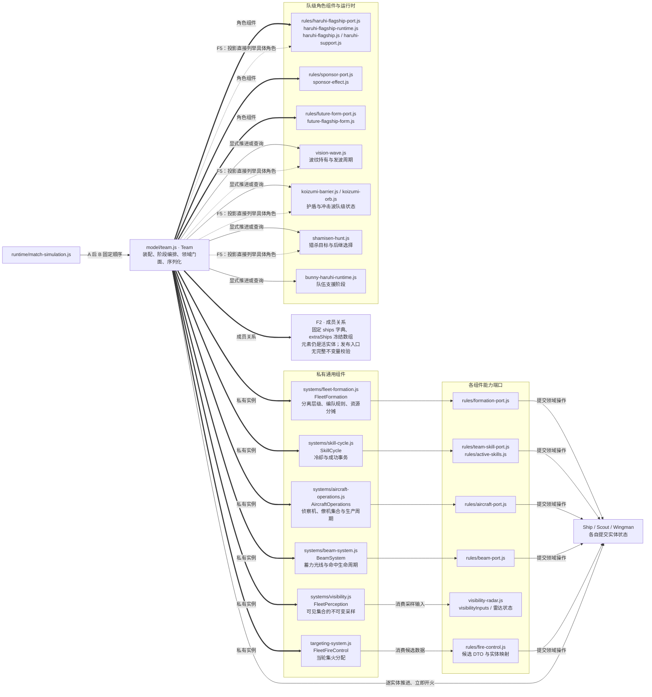
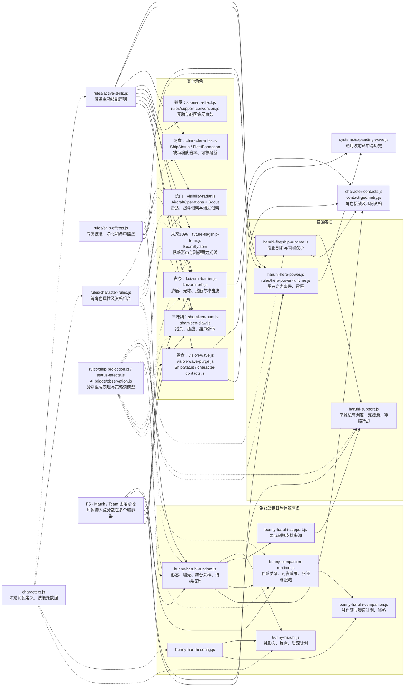
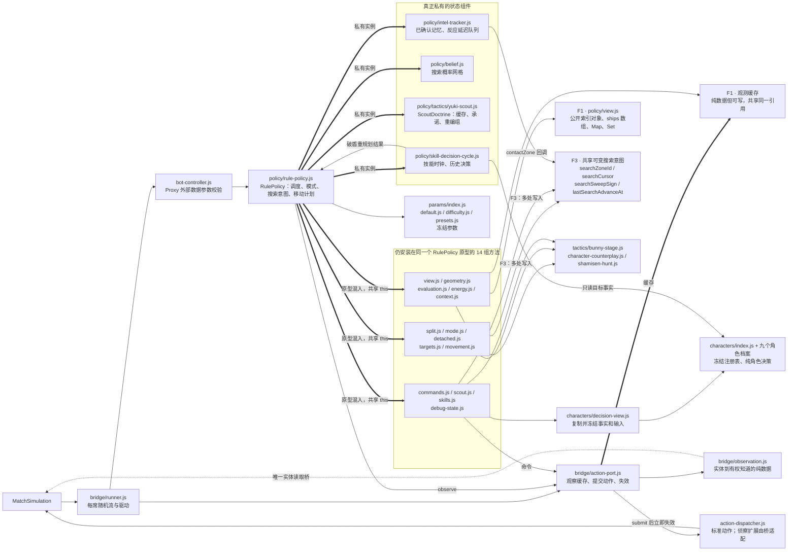
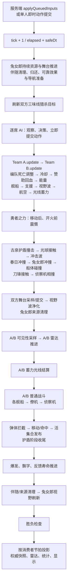
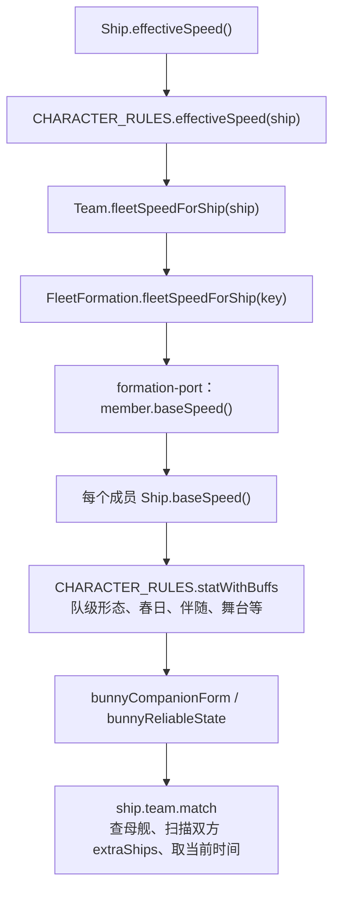
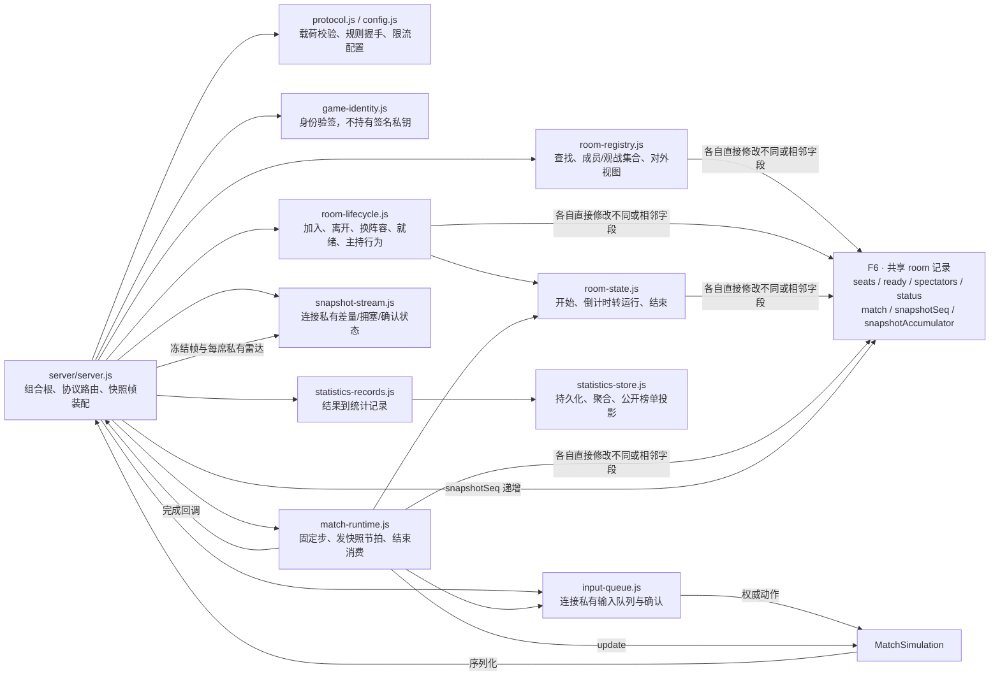

# 游戏模块架构图与残留问题

源码基线：`c60f9b9`，2026-10-11。本次只绘图、核对代码和运行隔离内存探针，不修改游戏规则或运行逻辑。

这是一张分成八个视图的架构地图。图中的箭头按标签表示调用、数据流或状态持有，不等同于 import；模块名省略共同目录时在图前注明。`F1`～`F6` 对应后面的残留问题。静态模块全量索引见 [模块索引](architecture-module-index.md)。

**结论：现在已经具备组件化结构，但内部写权限与求值依赖还没有完全收口。** 导航、技能周期、情报等组件的私有状态是真正拆出了；AI 其余启发式仍是同一个大策略的原型方法，基础实体仍可直接写，角色运行时仍能通过实体访问整个世界。以下将已经成立的边界和这些残留同时画出。

## 图一：权威、输入、传输与表现

关键边界：单人会话与联机传输已经隔离权威和显示。AI 不从显示插值取数据。服务端公开快照与每席雷达分开装配；不能把“所有 UI 都读同一份世界快照”误解为所有玩家都获得相同的私有雷达。

## 图二：Ship 内部职责与写权限

下列相对路径均位于 `shared/game/`。

私有组件不是单纯分文件：外部不能修改导航的航线对象、状态生效帧或射击计时内部存储。但这不等于整个 Ship 已经只读：公开标量仍可绕过 `takeDamage`、`restoreEnergy`、`displaceTo`、`transferToTeam` 等操作。冻结 Team 的槽位字典也不会冻结字典里指向的 Ship。

## 图三：Team 的组件、装配与剩余职责

角色效果要生成实体或转移阵营时，会调用集合所有者的领域操作；这种跨所有者命令本身是合理的。问题在于集合所有者必须最终保证唯一性和归属，而不能完全依赖每个角色调用者正确配对调用。

## 图四：九角色的运行时与消费关系

| 角色 | 主要权威状态所有者 | 写入/消费的特殊约束 |
| --- | --- | --- |
| 春日 | 强化组件、支援来源存储、勇者之力运行时 | 强化与支援解锁顺序不变；震慑必须在开火前生效 |
| 兔女郎春日 | 形态/舞台运行时、支援来源存储 | 形态和解锁一起发布；双方舞台先采样后提交 |
| 伴随阿虚 | 伴随运行时、每个接收者的可靠效果、舰体资源 | 母舰关系、临时策反、归还、弹体清理保持同步事务 |
| 阿虚 | ShipStatus 与舰体资源；被动倍率是规则查询 | 增益生效帧保护；回血只通过舰体操作 |
| 长门 | 雷达运行时、航空组件、Scout 自身 | 出生时采样战斗能力；策反后不能错误重新采样身份 |
| 古泉 | 护盾/光球模块的私有状态 | 特殊移动与接触资格即时可见；命中历史不泄露 |
| 未来1096 | FutureFlagshipForm、BeamSystem | 形态先提交再换算；光线先固定命中集合再投递 |
| 鹤屋 | SponsorEffect；策反由适配事务协调 | 阵营/集合/伴随效果一起变更；失败退款顺序不改 |
| 朝仓 | 视野波运行时、ShipStatus | 净化双方先采样；同帧新增效果的保护不能被顺序吞掉 |
| 三味线 | 猎杀与抓痕模块、ShipStatus | 攻击增幅先于分摊；击杀后继效果同步完成 |

角色身份、具体效果 ID 和策略中的角色战术本来就属于领域知识，不能因为出现 `characterId` 就判定耦合错误。真正要限制的是角色模块获得的写权限、对世界对象的可达范围，以及接入新角色时需要修改的中心模块数量。

## 图五：AI 的实际内部结构

相对路径位于 `shared/game/ai/`，BotController 位于上一级。

AI 已经没有实体兼容通道，动作也回到经过领域资格检查的执行路径。这项改善是真的。剩余问题在于内部仍缺少统一只读的观测与索引，以及几个策略模块对同一搜索意图的隐式修改；不能再把“没有实体引用”与“AI 内部已经解耦”画上等号。

## 图六：实际单帧顺序

此图来自 `MatchSimulation.update()`，保持代码顺序。箭头是先后顺序，不是模块 import。A、B 的顺序是当前行为的一部分。

不能把所有状态“延后统一消费”。伤害分摊、死亡、封印、支援、净化、技能冷却及后续 AI 观察都存在同帧因果关系。可集中的是各状态的写入所有者和阶段入口；只对需要公平同时观察的规则先统一采样，例如双方舞台与净化目标。

## 图七：属性查询仍存在的运行期回绕

下面是具体的方法调用链，而不是抽象层级。它会终止，**不是无限递归**；问题是能力求值跨越多次所有者和整个世界，依赖范围隐含在闭包与实体引用里。

改进方向是把参与本次属性计算的事实和关系查询缩窄，形成有明确失效条件的属性求值输入；保留必须即时读取的部分。不能粗暴地在帧开始缓存所有属性，否则分离、变身、策反、净化后的同帧属性会失真。

## 图八：服务端房间、状态与持久边界

输入队列和连接快照状态已经私有化。房间本身仍是多个模块共同持有的可写记录。当前路径有明确顺序，但不变量仍由协作约定而非房间所有者统一保证；这是战斗内部之外的后续改进项，不是已确认的联机错误。

## 从图中确认的六项残留

优先级表示架构治理顺序，**不表示线上事故或安全漏洞等级**。F1～F3 有隔离内存探针；F4～F6 是已核对调用链的设计分析。

### F1：AI 的纯数据观测与索引仍共享可变引用（优先）

- [action-port.js:60](../shared/game/ai/bridge/action-port.js#L60) 缓存 `buildObservation()` 的结果并直接返回；`strict` 只做 JSON 往返，不冻结。
- [view.js:6](../shared/game/ai/policy/view.js#L6) 返回内部 `observationIndex`，其中数组、Map、Set 可写，元素又指向同一份观测。
- 探针：把 `observe().self.ships.main.hp` 写成 13，下一次 `observe()` 仍得到 13，而权威生命保持 880。普通和 strict 模式均成立。
- 因此目前不会借该引用直接修改游戏实体，但会污染后续 AI 判断；观测对象不换引用时，索引缓存也不会重建。
- 建议：端口发布深只读观测；索引由独立私有 `ObservationView` 持有；消费者只取得查询或只读数组，不取得 Map/Set。继续保留动作提交后的立即失效。

### F2：实体基本状态与成员不变量尚未封闭（优先）

- [ship.js:34](../shared/game/model/ship.js#L34) 仍公开写入 `team/hp/energy/x/y/speed/alive` 等字段；`formationOffset` 也是可写对象。
- [team.js:49](../shared/game/model/team.js#L49) 发布冻结槽位容器，内部元素仍是活实体；[team.js:210](../shared/game/model/team.js#L210) 的成员发布直接追加，没有校验归属和重复。
- 探针：直接赋值 `ship.hp = -5`，`alive` 仍为 true，绕过死亡事务。把 B 主舰两次加入 A 的额外舰船集合也被接受，尽管数组本身冻结。
- 这些反例证明写入口能绕过，不证明正常游戏已经这样调用。目前角色生产路径主要使用领域命令，前轮改进有效。
- 建议：私有化核心资源/运动/归属字段并发布 getter；训练装配与测试场景用显式构造契约；独立成员所有者保证唯一性、角色资格和跨队转移事务。不要仅在外面再套一个冻结数组。

### F3：AI 仍是原型拼装的大策略，搜索意图有多个写者（优先）

- [rule-policy.js:361](../shared/game/ai/policy/rule-policy.js#L361) 将 14 组方法安装到同一个原型；文件分开了，`this` 仍是同一份状态和能力集合。
- [scout.js:33](../shared/game/ai/policy/scout.js#L33)、[targets.js:6](../shared/game/ai/policy/targets.js#L6) 都修改 `searchZoneId`；[rule-policy.js:75](../shared/game/ai/policy/rule-policy.js#L75) 的情报回调也修改它。
- 探针：调用看起来用于选择侦察区的 `pickScoutZoneId`，搜索意图从 4 变成 1。额外调用一次选区可能影响后续走位，而不是只得到一个候选值。
- 建议：`SearchNavigationState` 统一消费接触、探测与到达事实，持有搜索游标；选区和目标计算返回候选，不提交状态。RulePolicy 只按原顺序协调候选、动作与结果。
- 已拆出的 IntelTracker、SearchBelief、ScoutDoctrine、SkillDecisionCycle 应保留，不能因为尚有残留而否认这些真实边界。

### F4：角色适配器权限过宽，属性求值仍反复经过实体与世界（第二步）

- [character-rules.js:157](../shared/game/rules/character-rules.js#L157) 读取队级与多个角色效果；[character-rules.js:167](../shared/game/rules/character-rules.js#L167) 通过 Team 和编队组件反查成员属性。
- [formation-port.js:13](../shared/game/rules/formation-port.js#L13) 回调实体的 `baseSpeed()`；[bunny-companion-runtime.js:78](../shared/game/bunny-companion-runtime.js#L78) 又沿 `ship.team.match` 查整个伴随集合。
- 通用算法已不再直接枚举角色状态，这是好的；但“依赖倒置”只完成了一半，角色适配器仍可访问整个实体对象图。测试替换一个能力函数，不能证明其真实实现的读取范围受限。
- 建议：按属性、伤害、控制、可见性、成员关系拆成有明确输入的求值契约；角色运行时取得有限关系查询和效果提交能力。处理同帧失效，不强行统一延后。

### F5：角色接入仍分散于中央装配、推进、规则和投影（第二步）

- [match-simulation.js:398](../shared/game/runtime/match-simulation.js#L398) 直接列出角色推进、碰撞、清理；[team.js:405](../shared/game/model/team.js#L405) 继续编排队级角色；[team.js:518](../shared/game/model/team.js#L518) 自己列举角色投影。
- 另外还需要同步 `SHIP_EFFECTS`、`CHARACTER_RULES`、主动技能声明、状态投影及 AI 观测。新增复杂角色的改动面仍跨越多个中央入口，容易漏掉清理或投影。
- 建议：先建立明确的角色装配模块，声明初始化、能力、投影以及允许参加的固定阶段；框架持有阶段顺序。仅登记已存在的阶段，不引入任意事件广播，不把所有角色塞入同一个巨大配置解释器。
- Ship/Team 仍较长并不是充分证据；真正的证据是它们同时负责装配、角色阶段、领域命令和协议投影。

### F6：房间状态仍跨模块共享修改（后续）

- [room-state.js:2](../server/room-state.js#L2) 写比赛阶段与重置字段；[match-runtime.js:63](../server/match-runtime.js#L63) 写快照累加器；[server.js:246](../server/server.js#L246) 写房间快照序号。
- [room-lifecycle.js:277](../server/room-lifecycle.js#L277) 写就绪集合；[room-registry.js:79](../server/room-registry.js#L79) 整理观战集合。
- 这里不是“多个模块分别写不相干字段就一定错误”，而是共享 room 可达全部字段，跨字段约束缺少统一所有者。当前生命周期顺序正确不代表边界已被代码强制。
- 建议：房间聚合持有席位、就绪、阶段与比赛；快照调度持有序号和累加器；查询/序列化只拿读模型。避免再按文件名拆分函数但共享整个 room。

## 已成立的边界与不应误改的部分

| 边界 | 已成立的约束 | 不能据此推出的结论 |
| --- | --- | --- |
| AI 实体桥 | 策略不接收真实 Ship/Team，动作经执行适配 | 不代表 AI 观测和内部计划不可变 |
| 组件私有状态 | 导航、火控、技能周期、记忆等真实私有 | 不代表实体所有标量或成员关系私有 |
| 角色支援快照 | 不可作为写凭证，历史快照稳定 | 不代表所有角色模块只持有受限能力 |
| 通用战斗算法 | 通过端口消费，未直接读取角色状态字段 | 不代表能力求值实现没有实体回绕 |
| 单人/联机表现 | 消费权威投影，显示插值不写回 | 不代表服务端房间记录已经独占写入 |
| 固定步与即时事务 | 关键同帧顺序已有回归基线 | 不代表可以任意重排阶段或统一帧尾提交 |

## 建议的下一轮顺序和完成标准

1. **观测和索引只读**：同一个采样可复用，但任何消费方不能修改；动作后观察到最新权威状态。
2. **实体与成员写入口关闭**：非法直接赋值被拒绝；合法训练、转队、生成、伤害与移动均由所有者操作完成；跨队和重复成员被所有者拒绝。
3. **搜索意图独占**：重复调用选区/目标查询不改变状态；更新只由明确事实与动作结果推进；保持现有随机消费和决策顺序。
4. **缩窄角色求值上下文**：先处理图七这样的具体链，再扩展到控制、伤害与可见性；不能用缓存引入跨阶段陈旧属性。
5. **集中角色装配与投影挂接**：新增角色不必同时修改 Match、Team、Ship 三个实体的内部生命周期；阶段排序仍显式可审阅。
6. **房间聚合所有权**：把外围共享记录收回，独立验证就绪、倒计时、断线、结束、快照序号和统计消费。

每项都需要“越界操作失败”的负向证据、既有角色行为断言和未重刷的原始回放。仅减少类行数、改目录、增加代理方法或跑绿旧测试，都不算完成标准。

## 本次分析的验证范围

已核对当前源码的引用、装配、实际方法调用和状态写者；五个隔离内存探针通过（普通/strict AI 缓存、公开生命、成员关系、侦察选区副作用）。探针只创建临时内存对局，没有访问网络或身份/统计数据，日志位于 `.cache/architecture-map-probes.log`。这些是边界可绕过的证据，不是游戏故障复现。

八幅 Mermaid 图均已通过解析与浏览器渲染，已检查核心图的实际布局；模块索引覆盖 218 个 JavaScript 模块，本地链接及引用行号均已校验。

本次只增加图与分析文档，未重跑整套游戏门禁，也未声称发现新的线上缺陷。源码基线之前的完整回归结果见 [第十一轮记录](architecture-refactor.md#第十一轮以角色为中心追踪能力和状态别名)。
