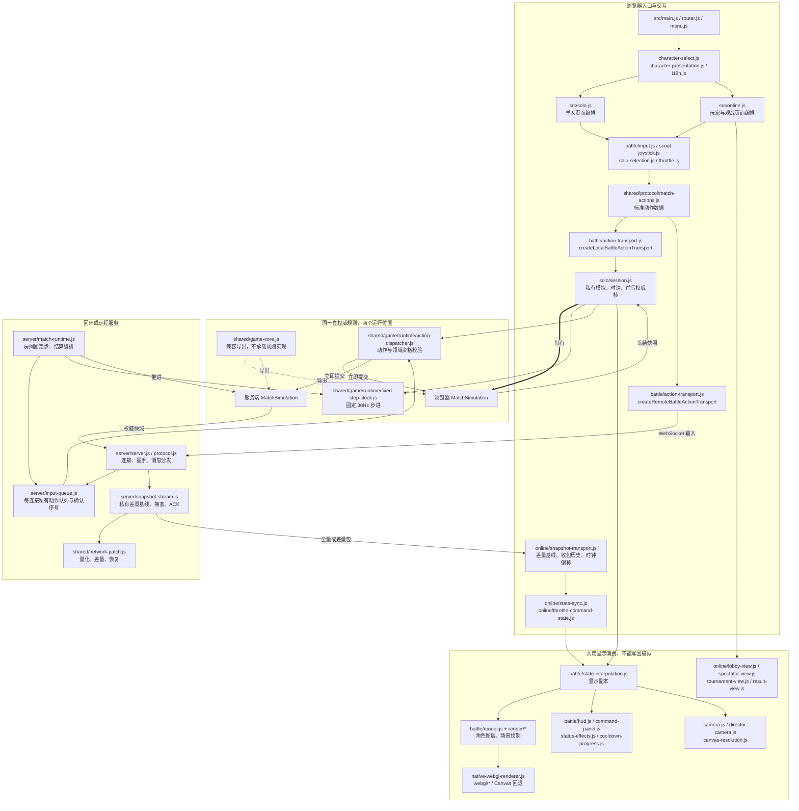
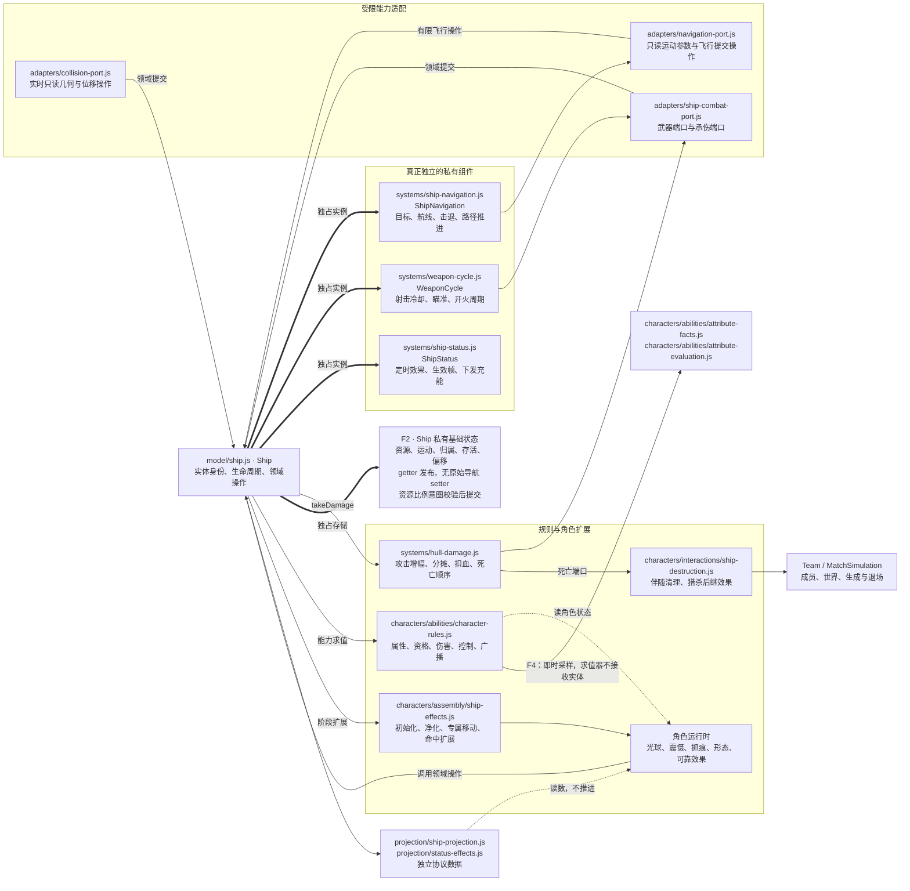
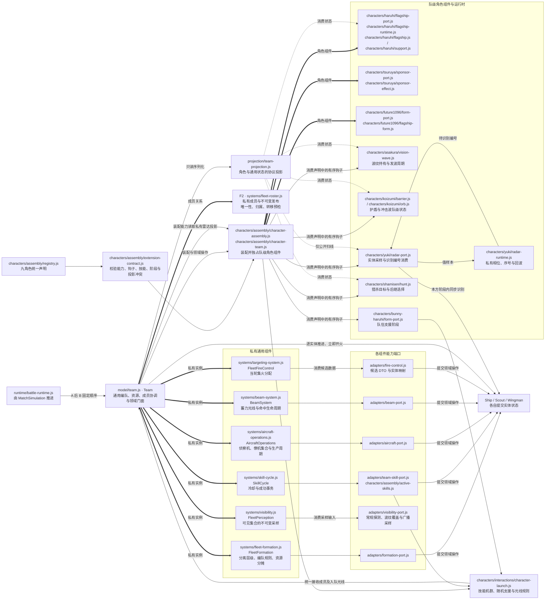
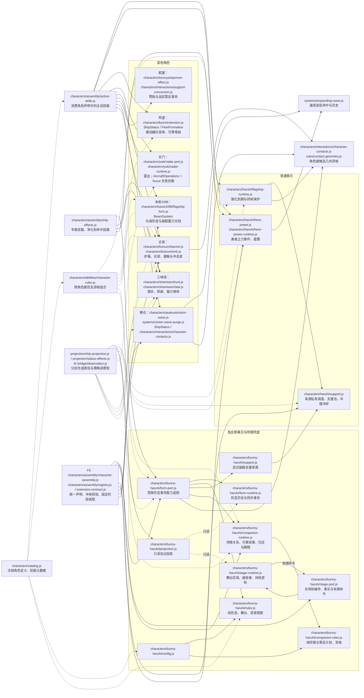
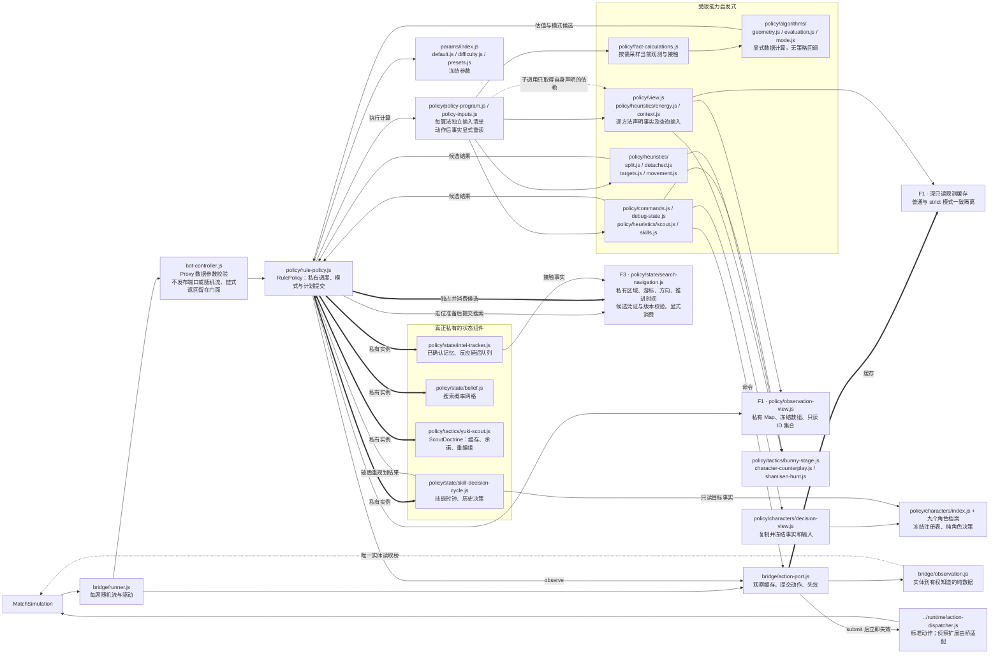
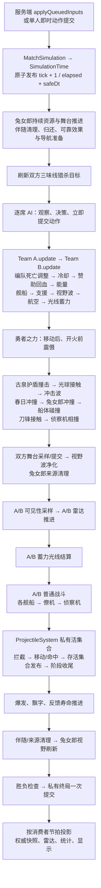
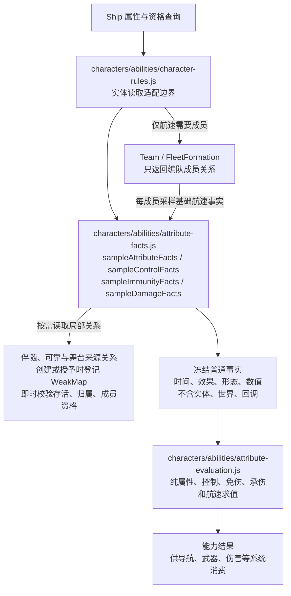
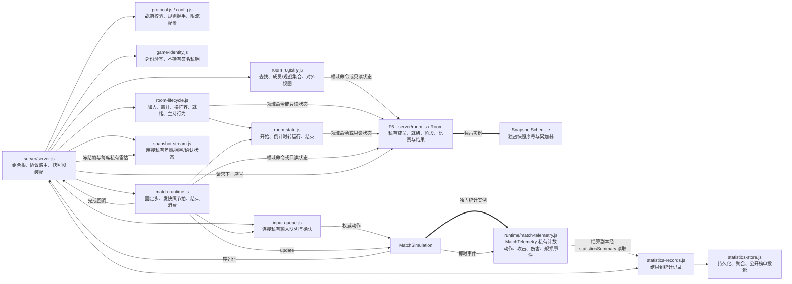
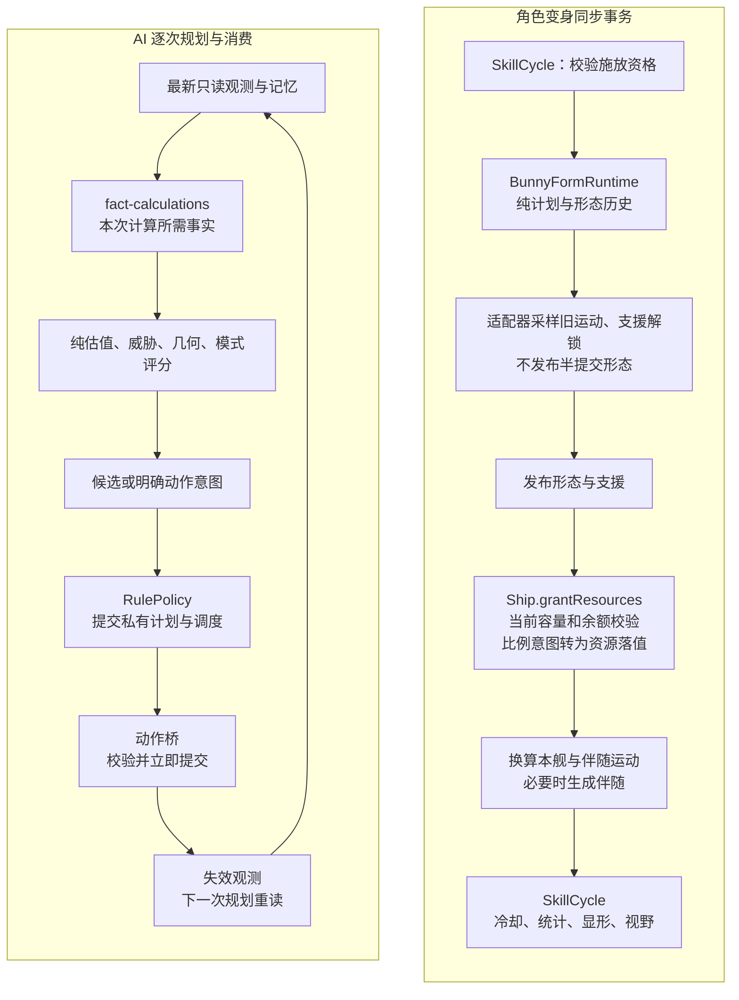
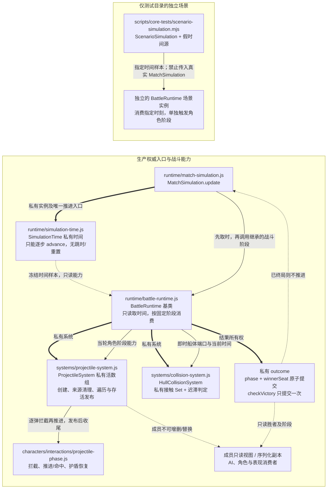

# 游戏模块架构图与状态所有权

行为基线：`9139545`；边界与路径更新于 2026-10-13，与本文件同提交的源码对应。原始问题及探针保留在 Git 提交 `c30d1a2`；本图展示落实后的结构，实施和验收见 [重构记录](architecture-refactor.md)。

这是一张分成十个视图的架构地图。图中的箭头按标签表示调用、数据流或状态持有，不等同于 import；模块名省略共同目录时在图前注明。`F1`～`F6` 对应后面的完成对照。目录选择与任务定位见 [战斗代码导航](../shared/game/README.md)，静态模块全量索引见 [模块索引](architecture-module-index.md)。

已经收回的写权限包括实体资源、组件状态、AI 记忆、角色运行时、对局开关和统计计数：AI 只消费冻结观测与候选，角色求值消费事实，角色装配与固定阶段归角色层，房间聚合独占成员和生命周期。对局本身的剩余公开状态另列在末尾复查清单中。图中仍保留必要的跨所有者命令与适配关系；它们必须通过领域操作同步完成，不能退回共享字段赋值。

## 图一：权威、输入、传输与表现

关键边界：单人会话与联机传输已经隔离权威和显示。AI 不从显示插值取数据。服务端公开快照与每席雷达分开装配；不能把“所有 UI 都读同一份世界快照”误解为所有玩家都获得相同的私有雷达。

## 图二：Ship 内部职责与写权限

下列相对路径均位于 `shared/game/`。

导航、武器、效果分别持有自己的状态，Ship 持有基础机体与生命周期。生命、能量、坐标、存活和归属不能直接赋值；航线、目标、击退和武器周期也不再有属性 setter，航线不能由外部构造进度和长度；角色效果只能提交位移、资源比例意图、伤害等领域操作。`grantResources` 使用当前容量与余额计算消耗、恢复及保底，拒绝未知字段、非法比例、致死消耗与死亡奖励；不再接收最终 hp/energy 覆盖值。Scout/Wingman 同样私有持有运动、任务、武器和寿命，任务输入隔离引用，成员发布和转移校验归属与唯一性。

## 图三：Team 的组件与角色装配边界

长门雷达状态只归 `RadarRuntime` 所有；它不持有 Team、Ship、Match 或端口回调，仅接受位置、可见性、时间等值样本，返回待识别编号。`radar-port` 同步提交识别，随后才处理另一方；该标志不参与同轮其他目标的扫描计算。Team 通过角色装配能力读取私有回波，公开投影只读扫线。通用视野适配器不再保存长门状态。

角色效果要生成实体或转移阵营时，会调用集合所有者的领域操作；这种跨所有者命令本身是合理的。集合所有者现在统一验证唯一性和归属，实体转移先验证后修改双方成员。伴随转换先预检，再同步清理可靠效果和弹体、提交角色状态；失败不产生部分副作用。

## 图四：九角色的运行时与消费关系

| 角色 | 主要权威状态所有者 | 写入/消费的特殊约束 |
| --- | --- | --- |
| 春日 | 强化组件、支援来源存储、勇者之力运行时 | 强化与支援解锁顺序不变；震慑必须在开火前生效 |
| 兔女郎春日 | BunnyFormRuntime、BunnyStageRuntime、支援来源存储 | 形态和解锁一起发布；双方舞台先采样后提交 |
| 伴随阿虚 | 伴随运行时、每个接收者的可靠效果、舰体资源 | 母舰关系、临时策反、归还、弹体清理保持同步事务 |
| 阿虚 | ShipStatus 与舰体资源；被动倍率是规则查询 | 增益生效帧保护；回血只通过舰体操作 |
| 长门 | 雷达运行时、航空组件、Scout 自身 | 出生时采样战斗能力；策反后不能错误重新采样身份 |
| 古泉 | 护盾/光球模块的私有状态 | 特殊移动与接触资格即时可见；命中历史不泄露 |
| 未来1096 | FutureFlagshipForm、BeamSystem | 形态先提交再换算；光线先固定命中集合再投递 |
| 鹤屋 | SponsorEffect；策反由适配事务协调 | 阵营/集合/伴随效果一起变更；失败退款顺序不改 |
| 朝仓 | 视野波运行时、ShipStatus | 净化双方先采样；同帧新增效果的保护不能被顺序吞掉 |
| 三味线 | 猎杀与抓痕模块、ShipStatus | 攻击增幅先于分摊；击杀后继效果同步完成 |

角色身份、具体效果 ID 和策略中的角色战术本来就属于领域知识，不能因为出现 `characterId` 就判定耦合错误。真正要限制的是角色模块获得的写权限、对世界对象的可达范围，以及接入新角色时需要修改的中心模块数量。

## 图五：AI 的实际内部结构

相对路径位于 `shared/game/ai/`，BotController 位于该目录的 `bot-controller.js`。

AI 没有实体兼容通道，也不再通过 `port/rng` getter 或配置操作的链式返回泄露底层能力。观测与索引只读；搜索候选查询不推进游标，实际命令显式消费候选。启发式不再安装到 RulePolicy 原型，也没有隐式 this 或共同继承的大读取上下文。每个算法在参数与 policy-inputs 中明确声明直接依赖；查询不能取得动作与调度权限。战力、威胁、几何和模式计算直接接收事实；随机模式规划显式消费随机能力并返回结果。执行算法通过明确的重读函数取得动作后的新观测。走位由协调器先读准备事实，再提交搜索与模式，最后执行路线，不从启发式绕回协调器选模式。卡死采样和移动结果返回协调器提交；能量算法返回换挡意图；分离由协调器逐次规划和提交，第二次规划重新观察第一次动作结果。诊断只读，不靠覆写策略方法采样。情报外推只在同一观测和参数下复用，动作后立即失效。

## 图六：实际单帧顺序

此图来自 `MatchSimulation.update()` 的取时步骤与 `BattleRuntime.update()` 的战斗阶段，保持代码顺序。箭头是先后顺序，不是模块 import。A、B 的顺序是当前行为的一部分。AI 与常规开火开关由对局私有持有，外部只能调用设置方法；每席轮到执行时读取当前开关，因此前一席的变更立即影响后一席。

不能把所有状态“延后统一消费”。伤害分摊、死亡、封印、支援、净化、技能冷却及后续 AI 观察都存在同帧因果关系。可集中的是各状态的写入所有者和阶段入口；只对需要公平同时观察的规则先统一采样，例如双方舞台与净化目标。

## 图七：属性、控制与承伤的事实求值

不再存在 `FleetFormation → member.baseSpeed() → 角色 → 世界扫描` 的求值回绕。属性变化仍即时采样：变身、分离、封印、策反、净化和死亡影响同帧后续查询，不在帧头统一缓存。适配层可读取实体，纯求值器不能；生成与转移等事务仍需跨所有者协调，不能把事务适配误称为纯函数。

## 图八：服务端房间、状态与持久边界

房间成员、就绪、阶段和结算统一由 Room 提交。连接层仍负责权限、通知和连接记录，运行器通过领域命令推进比赛和快照时钟；它们不能直接修改房间字段。观战集合、席位、就绪和结果均只读，历史视图不追随后续提交。

## F1～F6 完成对照

| 项 | 实际所有者与契约 | 反向验证 |
| --- | --- | --- |
| F1 观测与索引 | action-port 深冻结；ObservationView 私有索引 | 普通/strict 写入拒绝，历史观测稳定，成功及失败动作后失效 |
| F2 实体与成员 | Ship/Scout/Wingman 私有状态；FleetRoster/AircraftOperations 独占发布 | 标量/嵌套修改拒绝；重复、错误归属、跨对局拒绝；转移失败无部分副作用 |
| F3 AI 内部多写 | SearchNavigation 候选及消费；RulePolicy 私有计划与调度；PolicyProgram 只读上下文 | 重复查询不推进；伪造、过期、重复候选拒绝；外部不能写计划与时钟 |
| F4 求值回绕 | 按用途采样的冻结事实与纯求值器；局部来源关系 | 无实体/回调；历史稳定；同帧变身、净化与归属变化立即生效 |
| F5 角色接入 | CHARACTER_EXTENSIONS 统一声明主动技能、规则、钩子、队级/对局工厂及投影；装配器校验 | 独立声明直接接入；未知阶段、重复顺序、能力/投影冲突与覆盖生命周期均拒绝 |
| F6 房间多写 | Room 聚合；SnapshotSchedule | 重复席位、冒名就绪、外部赋值拒绝；倒计时/运行/完成及快照顺序保持 |

对应源码分别见 [观测端口](../shared/game/ai/bridge/action-port.js)、[舰船](../shared/game/model/ship.js)、[搜索所有者](../shared/game/ai/policy/state/search-navigation.js)、[属性事实](../shared/game/characters/abilities/attribute-facts.js)、[角色装配](../shared/game/characters/assembly/character-assembly.js)、[房间聚合](../server/room.js)。测试入口为 `scripts/verify-domain-boundaries.mjs`，完整证据记录在重构记录中。

## 保留的合理耦合与验收边界

- 角色规则知道角色身份、形态及效果含义；通用算法只消费能力或事实。封装的目标是限制权威存储和职责，不是消除全部领域依赖。
- 角色事务适配层负责生成、转移、清理、命中等跨所有者操作，仍会取得领域实体；它只能使用领域命令，不能直接修改私有存储。纯求值层不取得这些能力。
- Team/Match 保留领域门面，已有调用者和测试可调用明确操作；角色状态、投影和阶段顺序已转交对应所有者，门面不再保存第二份状态。
- 冻结 AI 观测、事实和历史会产生分配开销；只在有明确身份和失效规则的地方复用。没有通过改变规则、延迟到帧尾或重刷回放来换取性能。
- 自动化覆盖固定种子、全部核心角色、浏览器和本地网络；不能推导出任意对局穷尽证明，也不替代真人多端体验。未推送、未部署。

## 沿角色调用链的再次复查（2026-10-11）

本轮不以依赖图无环代替判断；核对了装配、施放、属性读取、移动/击退、支援生成、弹体与承伤、伴随转队/死亡清理，以及 AI 观察→候选→提交→重新观察的实际链路。

| 本轮残留 | 原来的实际问题 | 现在的所有权边界 |
| --- | --- | --- |
| 专属发射回绕 | 春日/长门运行时经 Team 进入通用航空组件，由后者持有技能参数与随机生成规则 | `character-launch` 决定专属规则，Team 接收成员/光线，航空组件只管理生产与生命周期 |
| Ship 原始替换入口 | 私有组件仍接受航线、目标、击退和冷却 setter，航线长度/进度可以绕过几何约束 | 只读属性；航线通过导航约束生成，击退同步停船清航线，完成时失效读视图 |
| AI 过宽能力及回绕 | 冻结启发式上下文仍能提交动作、推进搜索、回调策略选模式 | 查询与执行分开；每个执行入口列出能力，搜索/模式提交由 RulePolicy 顺序编排 |
| AI 对外能力泄露 | 策略 getter 发布动作端口/随机流，链式配置返回原始策略，可绕过门面校验 | 底层能力留在桥接和策略内部，链式调用继续返回受校验门面 |
| 支援旧快照消费 | 冷却消费相信调用方的旧资格样本，重复使用可能重入消费 | 私有所有者重新校验并提交，旧样本不能授权或阻止当前消费 |

保留的关系均有明确用途：成员集合里的活实体用于同步领域命令；承伤仍即时分摊并完成死亡收尾；属性适配层组合可替换的规则能力；角色运行时持有来源身份以处理同帧死亡与转队。这些调用保留即时状态语义，不把内部可写容器交给消费者。

## 图九：资源事务与 AI 计划的实际消费边界

资源校验失败不会部分扣费或发放同次资源奖励；角色事务仍在既有同步调用栈中完成。需要同步观察双方的舞台只统一采样区域；伤害、死亡、分离和后续 AI 观察仍按图六的顺序即时消费。协议字段顺序由 `projection-order.js` 保留，角色自行贡献投影字段，投影不能推进状态。

四项工作的源码入口分别为 `model/ship.js`、`characters/bunny-haruhi/form-runtime.js` 与 `characters/bunny-haruhi/stage-runtime.js`、`characters/<角色>/extension.js` 与 `characters/assembly/extension-contract.js`、`ai/policy/fact-calculations.js` 与 `policy-inputs.js`。剩余实体引用集中在需要同步领域操作的适配器；纯状态机与数值算法不取得世界对象。该边界约束合作代码的职责，不宣称 JavaScript 模块是对恶意代码的安全沙箱。

## 2026-10-13 复查：已落实与下一层边界

本次沿实际读写入口发现并处理了三处残留：长门雷达的算法/状态与实体适配混合、AI/开火开关的对象直写入口、统计模块只拆函数而仍由 Match 公开计数表。对应实现和验收见 [重构记录](architecture-refactor.md)。

本次继续收紧后，时钟、终局、弹体集合和碰撞历史的开放入口均已关闭，见图十。还没有因此宣称整个对局聚合完全封闭：表现集合、实体编号源及部分装配引用仍可进一步收权，弹体实体本身也仍有公开字段；本次收回的是集合的创建、成员发布、来源清理与阶段消费权限。复查未发现生产模块绕过新的四类所有者写入；这不等于对其他状态作穷尽证明。

此外，一些角色端口仍需要完整领域对象完成生成、转移、承伤和立即查询；这是下一步收窄能力面的候选，但不能把必要的同步事务全部换成延迟事件。此次没有发现 AI 恢复实体兼容输入，通用组件仍由角色适配器提供规则能力；这只是本次检查范围的结论，不是全仓穷尽证明。

## 图十：逻辑时间、终局、弹体与接触历史

生产 MatchSimulation 不接受外部时钟；场景测试没有访问或覆写它的私有字段。世界依然使用同一套角色、实体、阶段和胜负规则，假时间源不复制战斗算法。真正的对局推进由时间专项、原始回放和权威一致性验证，不能以跳时场景替代。

弹体遍历捕获当轮的活数组，普通追加立即进入同轮；如果来源清理发布了另一个集合，本轮仍按原数组遍历和最终筛选，保持旧调用语义。存活集合发布后才执行收尾，收尾新增保留到下一帧。成员视图冻结的是成员关系，不把其中实体伪装成纯快照。碰撞系统逐对读取前一次位移后的实时几何，只在新接触时施加减速，释放余量和成员离场由系统自己更新历史。
